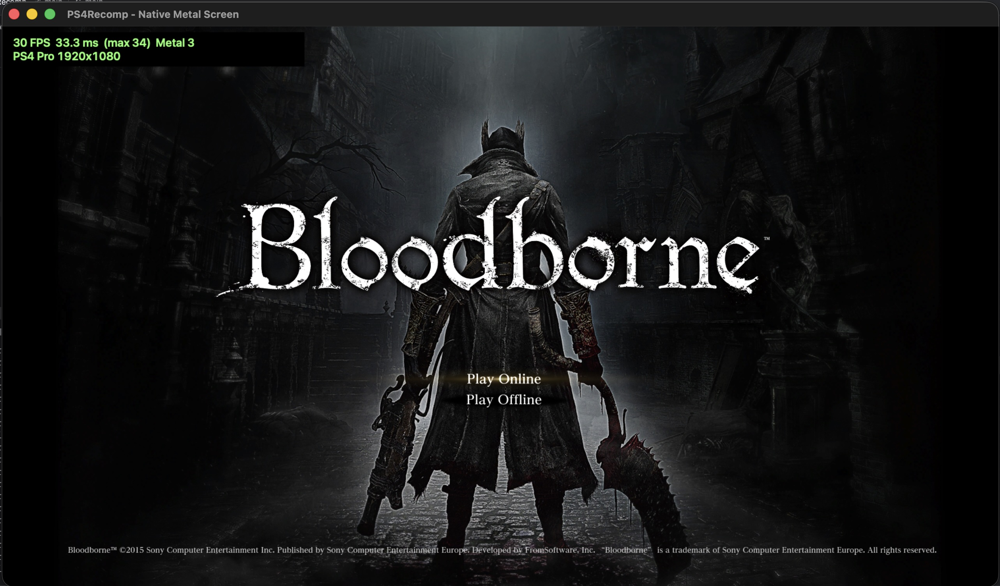
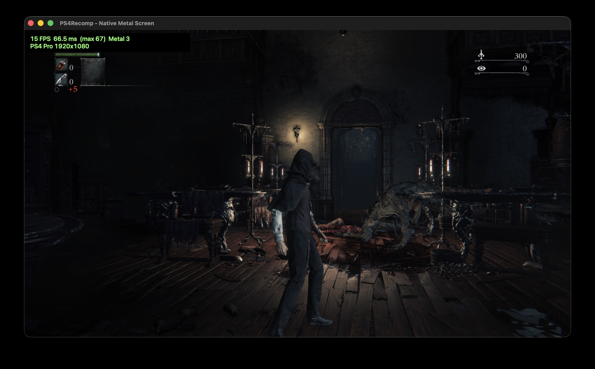
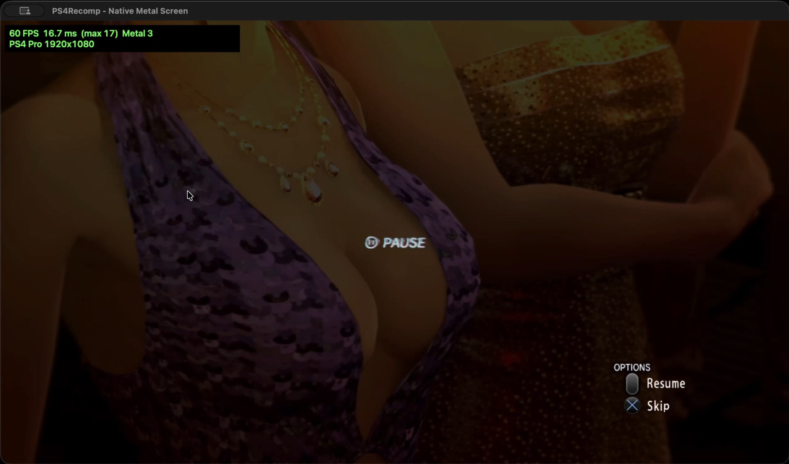
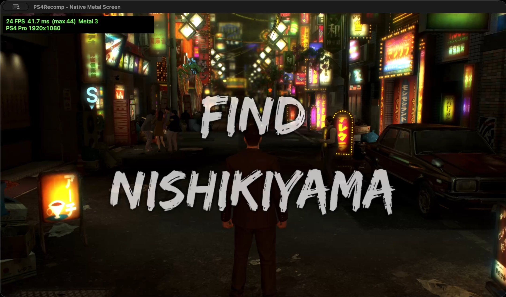

# PS4Recomp

A macOS Apple Silicon ahead-of-time (AOT) static recompiler that translates PlayStation 4 (x86-64 ELF) binaries into native ARM64 executables and standalone `.app` bundles. No JIT, virtual machines, or MoltenVK required.

|                                        |                                        |
| :------------------------------------: | :------------------------------------: |
|    |    |
|  |  |

---

## Highlights

- **Native ARM64 Assembly AOT**: Direct AMD64 to ARM64 assembly translation with parallel Clang assembly and x86 Total Store Order (`-tso`) acquire/release memory semantics.
- **Metal 3 / 4 Graphics Backend**: GCN bytecode to MSL translation via `gcn-recompiler` and SPIRV-Cross, direct Metal render/compute pipelines, frame pacing, and zero-copy UMA physical direct memory aliasing.
- **Orbis Kernel & Subsystems**: Multi-module TLS, fiber-aware pthread synchronization primitives, event queues (`libkernel` equeues), asynchronous I/O, and virtual filesystem virtualization (`/app0`).
- **Media & Hardware Integration**: 48 kHz multi-channel host audio mixer (`libSceAudioOut`), ATRAC9 audio decoding (`libSceAjm`), VideoToolbox hardware H.264 cutscene decoding (`libSceVideodec`), and native GameController support (`libScePad`).
- **macOS Bundle Packaging**: Automatic generation of self-contained macOS `.app` bundles with resource staging and ad-hoc code-signing.

---

## Compatibility Status

> PS4Recomp operates **exclusively on decrypted and extracted game folders** (`eboot.bin` and assets). For dumping/extracting PKG files on macOS using **[ps4-pkg-tools](https://github.com/xXJSONDeruloXx/ps4-pkg-tools)**

| Title                                    | Title ID    | Engine / Type       | Status                 | Notes                                                                                           |
| ---------------------------------------- | ----------- | ------------------- | ---------------------- | ----------------------------------------------------------------------------------------------- |
| **Yakuza 0**                             | `CUSA05070` | Kiwami Engine       | **Playble**            | Starts, settings works, cutscenes and gameplay works in first mission                           |
| **Bloodborne: Game of the Year Edition** | `CUSA03173` | FromSoftware Engine | **In-Game**            | Starts, settings, cutscenes and character editor works. The gameplay starts, but with artefacts |
| **The Last of Us Remastered**            | `CUSA00557` | Naughty Dog Engine  | **Bootable / In-Game** | Boots, renders 3D graphics and audio                                                            |
| **Hollow Knight: Silksong**              | —           | Unity 6             | **Suspended**          | Paused pending guest C++ exception unwinding in ARM64 backend                                   |
| **Hogwarts Legacy**                      | `CUSA12824` | Unreal Engine 4     | **In Progress**        | Recompiles; halts during early engine startup                                                   |

---

## Quick Start

### Prerequisites

- **macOS**: Apple Silicon (M1 / M2 / M3 / M4)
- **Go**: 1.22+
- **Xcode Command Line Tools**: `xcode-select --install`
- **Build Tools & Libraries**:
  ```bash
  brew install cmake ninja freetype ffmpeg
  ```

### Build from Source

```bash
# 1. Clone repository with submodules
git clone --recursive https://github.com/wie-project/PS4Recomp.git
cd PS4Recomp

# 2. Build standalone ps4-recomp binary
./scripts/build.sh
```

`scripts/build.sh` automatically checks submodules, builds required C/C++ static libraries (`gcn-recompiler`, `spirv-cross`, `libatrac9`), embeds runtime assets, and produces a single self-contained executable at `bin/ps4-recomp`.

---

## Usage

### Analyze an Executable or Game Folder

Inspect CFG, control flow, instruction compatibility, and referenced PRX modules:

```bash
./bin/ps4-recomp analyze path/to/game
# or directly on eboot.bin:
./bin/ps4-recomp analyze path/to/game/eboot.bin
```

### Recompile & Build Game

PS4Recomp automatically finds `eboot.bin` and game assets in the provided game directory:

```bash
# Basic compilation to native ARM64 macOS .app bundle:
./bin/ps4-recomp build path/to/game -o path/to/build

# Fully standalone macOS .app bundle (bundles all game assets and dylibs for distribution):
./bin/ps4-recomp build path/to/game -o path/to/build --standalone

# Compile and immediately run the game:
./bin/ps4-recomp build path/to/game -o path/to/build -run
```

Once built, launch the game by double-clicking `<GameName>.app` in Finder, or run from terminal:

```bash
./build/ps4_app
```

### Key CLI Options

| Flag                    | Description                                                                   | Default       |
| ----------------------- | ----------------------------------------------------------------------------- | ------------- |
| `-o`, `-out <dir>`      | Output directory for generated code, runtime, and `.app` bundle               | `"build"`     |
| `-e`, `-elf <file/dir>` | Path to input PS4 ELF binary or extracted game directory                      | Positional    |
| `-c`, `-compile`        | Compile emitted assembly to native ARM64 binary with Clang                    | `true`        |
| `-j`, `-jobs <num>`     | Number of parallel Clang assembler workers                                    | `NumCPU`      |
| `-O`, `-opt <level>`    | Clang optimization level (`0`, `1`, `2`, `3`, `s`, `z`)                       | `"2"`         |
| `-r`, `-run`            | Run the compiled binary after successful compilation                          | `false`       |
| `--standalone`          | Create a self-contained macOS `.app` bundle with bundled dylibs and resources | `false`       |
| `--tso`                 | x86 Total Store Order memory model (acquire/release semantics)                | `true`        |
| `--app-dir <dir>`       | Host directory mapping to `/app0` for game assets                             | Auto-detected |
| `--asan`                | Compile runtime with AddressSanitizer and LeakSanitizer                       | `false`       |

---

## Controls & Input Mapping

PS4Recomp provides native game controller support via Apple's GameController framework (DualShock 4, DualSense, Xbox Wireless, and Nintendo Switch controllers are detected automatically over Bluetooth or USB).

When playing without a physical controller, built-in keyboard emulation is active whenever the game window is focused:

### Keyboard to DualShock 4 Mapping

| PS4 Controller Input         | Primary Keyboard Key       | Alternative Key(s)         | Description                          |
| ---------------------------- | -------------------------- | -------------------------- | ------------------------------------ |
| **Left Stick / D-Pad Up**    | `W`                        | `Up Arrow`                 | Move forward / Menu Up               |
| **Left Stick / D-Pad Down**  | `S`                        | `Down Arrow`               | Move backward / Menu Down            |
| **Left Stick / D-Pad Left**  | `A`                        | `Left Arrow`               | Move left / Menu Left                |
| **Left Stick / D-Pad Right** | `D`                        | `Right Arrow`              | Move right / Menu Right              |
| **Right Stick Up**           | `Numpad 8`                 | `Page Up` (`Fn+Up`)        | Camera pitch up                      |
| **Right Stick Down**         | `Numpad 2`, `Numpad 5`     | `Page Down` (`Fn+Down`)    | Camera pitch down                    |
| **Right Stick Left**         | `Numpad 4`                 | `Home` (`Fn+Left`)         | Camera yaw left                      |
| **Right Stick Right**        | `Numpad 6`                 | `End` (`Fn+Right`)         | Camera yaw right                     |
| **Cross (✕)**                | `Space`                    | `Return` (Enter), `K`, `Z` | Confirm / Select / Action            |
| **Circle (◯)**               | `L`                        | `O`, `X`                   | Cancel / Back / Dodge / Dash         |
| **Square (◻)**               | `J`                        | `U`, `C`                   | Attack / Use Item                    |
| **Triangle (△)**             | `I`                        | `Y`, `V`                   | Heavy Attack / Switch Weapon         |
| **L1**                       | `Q`                        | —                          | Left Bumper / Guard                  |
| **R1**                       | `E`                        | —                          | Right Bumper / Light Attack          |
| **L2**                       | `Left Shift`               | `1`                        | Left Trigger (Full pull)             |
| **R2**                       | `Left Ctrl`, `Right Shift` | `2`, `3`                   | Right Trigger (Full pull)            |
| **L3**                       | `F`                        | —                          | Left Stick Click / Sprint            |
| **R3**                       | `G`                        | `B`                        | Right Stick Click / Target Lock      |
| **Options / Start**          | `Escape`                   | `Tab`, `P`, `M`, `R`       | Pause Menu / In-game Options         |
| **Touchpad Click**           | `T`                        | `` ` `` (Backtick)         | Gestures / Map / Inventory           |
| **Motion: Tilt Sideways**    | `H`                        | —                          | Emulate rolling controller 90° right |
| **Motion: Shake Controller** | `N`                        | —                          | Emulate SixAxis shake (1g at 6 Hz)   |
| **Quit Application**         | `Cmd + Q`                  | —                          | Cleanly terminate runtime            |

---

## Project Structure

```text
├── cmd/
│   ├── ps4-recomp/              # Main CLI entry point
│   └── lifter-difftest-asm/     # AMD64 vs ARM64 differential test harness                      # Guides (PKG extraction, dumping)
└── pkg/
    ├── analyzer/                # Reachable CFG & instruction coverage analyzer
    ├── disasm/                  # Instruction decoder & jump-table recovery
    ├── elfloader/               # ELF64/PRX parser & multi-module TLS linker
    ├── lifter/                  # AMD64 to ARM64 assembly lifter (TSO, SIMD, FPU)
    ├── emitter/                 # Assembly partitioner, bridge trampolines & NID shims
    └── runtime/                 # Host runtime & Orbis/POSIX kernel ABI
        ├── core/                # Guest context & Mach-O crash handlers
        ├── kernel/              # Direct memory, sync pools, threading, VFS
        └── modules/             # HLE modules (VideoOut, AudioOut, GnmDriver, Pad, etc.)
```

---

## Contributing Guidelines

- **English only**: All code comments, documentation, and commit messages must be written in English.
- **Strict verification**: All modifications must pass `go test -count=1 ./...` and `go vet ./...` cleanly with zero regressions. No artificial stubs returning 0 where honest implementation is required.
- **Clean code & low allocations**: Profile with Go analysis tools to ensure minimal allocations and memory safety.

---

## Credits & Acknowledgements

Special thanks to the open-source PlayStation emulation and research communities:

- **[shadPS4](https://github.com/shadps4-emu/shadPS4)** — HLE module architecture and system behavior documentation.
- **[OpenOrbis](https://github.com/OpenOrbis)** — Open-source PS4 toolchain and reverse engineering.
- **[ps4libdoc](https://github.com/idc/ps4libdoc)** — Symbol dictionaries and NID-to-name mappings.
- Forks of the project, which help to develop it further

---

## Legal Notice

PS4Recomp is an independent educational and research project into ahead-of-time binary translation. It does not distribute, bundle, or contain any copyrighted PlayStation 4 system libraries, firmware files, or proprietary encryption keys. "PlayStation", "PlayStation 4", "PS4", and "Orbis OS" are registered trademarks of Sony Interactive Entertainment Inc. All commercial game titles and assets belong to their respective owners.

---

## License

[GPL-2.0](LICENSE)
