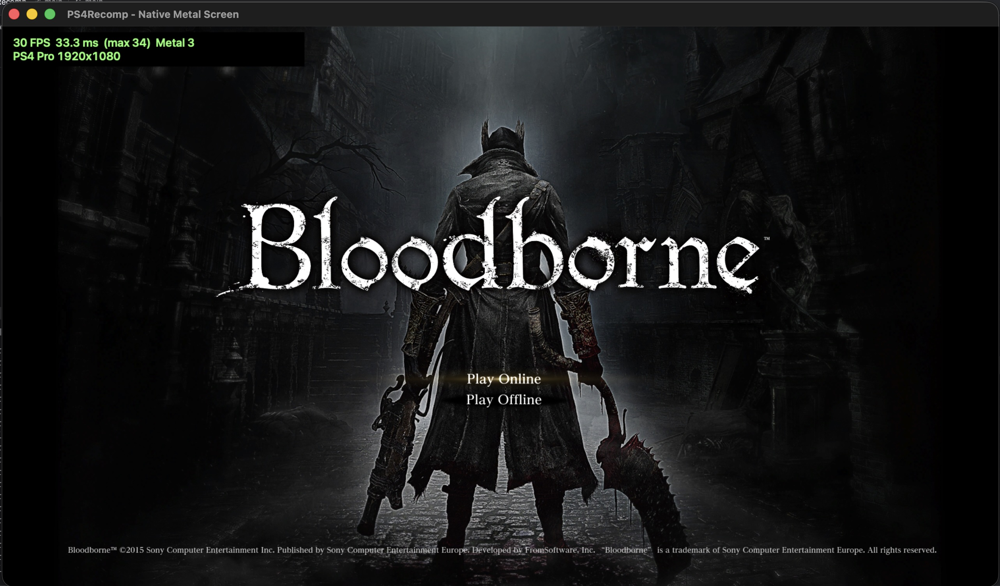

# PS4Recomp

A macOS Apple Silicon ahead-of-time (AOT) static recompiler that translates PlayStation 4 (x86-64 ELF) binaries into native ARM64 executables and standalone `.app` bundles. No JIT, virtual machines, or MoltenVK required.



---

## Highlights

- **Native ARM64 Assembly AOT**: Direct AMD64 to ARM64 assembly translation with parallel Clang assembly and x86 Total Store Order (`-tso`) acquire/release memory semantics.
- **Metal 3 / 4 Graphics Backend**: GCN bytecode to MSL translation via `gcn-recompiler` and SPIRV-Cross, direct Metal render/compute pipelines, frame pacing, and zero-copy UMA physical direct memory aliasing.
- **Orbis Kernel & Subsystems**: Multi-module TLS, fiber-aware pthread synchronization primitives, event queues (`libkernel` equeues), asynchronous I/O, and virtual filesystem virtualization (`/app0`).
- **Media & Hardware Integration**: 48 kHz multi-channel host audio mixer (`libSceAudioOut`), ATRAC9 audio decoding (`libSceAjm`), VideoToolbox hardware H.264 cutscene decoding (`libSceVideodec`), and native GameController support (`libScePad`).
- **macOS Bundle Packaging**: Automatic generation of self-contained macOS `.app` bundles with resource staging and ad-hoc code-signing.

---

## Compatibility Status

> PS4Recomp operates **exclusively on decrypted and extracted game folders** (`eboot.bin` and assets). For dumping/extracting PKG files on macOS using **[ps4-pkg-tools](https://github.com/xXJSONDeruloXx/ps4-pkg-tools)**

| Title                                    | Title ID    | Engine / Type       | Status                 | Notes                                                                   |
| ---------------------------------------- | ----------- | ------------------- | ---------------------- | ----------------------------------------------------------------------- |
| **Bloodborne: Game of the Year Edition** | `CUSA03173` | FromSoftware Engine | **Bootable**           | Boots, renders logo: halts during call of unimplemented function        |
| **The Last of Us Remastered**            | `CUSA00557` | Naughty Dog Engine  | **Bootable / In-Game** | Boots, renders 3D graphics and audio; gameplay verification in progress |
| **Hollow Knight: Silksong**              | —           | Unity 6             | **Suspended**          | Paused pending guest C++ exception unwinding in ARM64 backend           |
| **Hogwarts Legacy**                      | `CUSA12824` | Unreal Engine 4     | **In Progress**        | Recompiles; halts during early engine startup                           |

---

## Quick Start

### Prerequisites

- **macOS**: Apple Silicon (M1 / M2 / M3 / M4)
- **Go**: 1.22+
- **Xcode Command Line Tools**: `xcode-select --install`
- **Build Tools & Libraries**:
  ```bash
  brew install cmake ninja freetype
  ```

### Build from Source

```bash
# 1. Clone repository with submodules
git clone --recursive https://github.com/wie-project/PS4Recomp.git
cd PS4Recomp

# 2. Build 3rd-party dependencies
# SPIRV-Cross:
cd 3rdparty/spirv-cross
clang++ -O3 -std=c++17 -c spirv_cross.cpp spirv_cross_parsed_ir.cpp spirv_parser.cpp spirv_glsl.cpp spirv_msl.cpp spirv_cfg.cpp spirv_cross_c.cpp
ar rcs libspirv-cross.a *.o && rm -f *.o
cd ../..

# LibAtrac9:
cd 3rdparty/libatrac9
clang -O3 -c C/src/*.c
ar rcs libatrac9.a *.o && rm -f *.o
cd ../..

# GCN Shader Recompiler:
cd 3rdparty/gcn-recompiler
cmake -B build -G Ninja -DCMAKE_BUILD_TYPE=Release
ninja -C build
cp build/libgcn_recompiler.a .
cd ../..

# 3. Build ps4-recomp CLI
go build -o ps4-recomp ./cmd/ps4-recomp
```

---

## Usage

### Analyze an Executable

Analyze CFG, control flow, instruction compatibility, and referenced PRX modules:

```bash
./ps4-recomp analyze path/to/game/eboot.bin
```

### Recompile & Run

Recompile the game into a standalone macOS `.app` bundle:

```bash
# Basic compilation to native ARM64
./ps4-recomp path/to/game/eboot.bin -o build -compile

# Standalone macOS .app bundle with assets mapped and copied
./ps4-recomp path/to/game/eboot.bin \
  --app-dir path/to/game \
  --copy-resources \
  -o build \
  -compile -run
```

### Key CLI Options

| Flag                 | Description                                                    | Default       |
| -------------------- | -------------------------------------------------------------- | ------------- |
| `-o`, `-out <dir>`   | Output directory for generated code and binaries               | `"build"`     |
| `-c`, `-compile`     | Compile emitted assembly to native ARM64 binary with Clang     | `true`        |
| `-j`, `-jobs <num>`  | Number of parallel Clang assembler workers                     | `NumCPU`      |
| `-O`, `-opt <level>` | Clang optimization level (`0`, `1`, `2`, `3`, `s`, `z`)        | `"2"`         |
| `-r`, `-run`         | Run the compiled binary after successful compilation           | `false`       |
| `--tso`              | x86 Total Store Order memory model (acquire/release semantics) | `true`        |
| `--app-dir <dir>`    | Host directory mapping to `/app0` for game assets              | Auto-detected |
| `--copy-resources`   | Copy game assets into the macOS `.app` bundle `Resources/`     | `false`       |
| `--asan`             | Compile runtime with AddressSanitizer and LeakSanitizer        | `false`       |

---

## Project Structure

```text
├── cmd/
│   ├── ps4-recomp/              # Main CLI entry point
│   └── lifter-difftest-asm/     # AMD64 vs ARM64 differential test harness
├── docs/                        # Guides (PKG extraction, dumping)
└── pkg/
    ├── analyzer/                # Reachable CFG & instruction coverage analyzer
    ├── disasm/                  # Instruction decoder & jump-table recovery
    ├── elfloader/               # ELF64/PRX parser & multi-module TLS linker
    ├── lifter/                  # AMD64 to ARM64 assembly lifter (TSO, SIMD, FPU)
    ├── emitter/                 # Assembly partitioner, bridge trampolines & NID shims
    └── runtime/                 # Host runtime & Orbis/POSIX kernel ABI
        ├── core/                # Guest context & Mach-O crash handlers
        ├── kernel/              # Direct memory, sync pools, threading, VFS
        └── modules/             # HLE modules (VideoOut, AudioOut, GnmDriver, Pad, etc.)
```

---

## Contributing Guidelines

- **English only**: All code comments, documentation, and commit messages must be written in English.
- **Strict verification**: All modifications must pass `go test -count=1 ./...` and `go vet ./...` cleanly with zero regressions. No artificial stubs returning 0 where honest implementation is required.
- **Clean code & low allocations**: Profile with Go analysis tools to ensure minimal allocations and memory safety.

---

## Credits & Acknowledgements

Special thanks to the open-source PlayStation emulation and research communities:

- **[ps4-native-mac](https://github.com/manjarqo/ps4-native-mac)** — The first fork of the project, which provided significant assistance in moving the project forward
- **[shadPS4](https://github.com/shadps4-emu/shadPS4)** — HLE module architecture and system behavior documentation.
- **[OpenOrbis](https://github.com/OpenOrbis)** — Open-source PS4 toolchain and reverse engineering.
- **[ps4libdoc](https://github.com/idc/ps4libdoc)** — Symbol dictionaries and NID-to-name mappings.

---

## Legal Notice

PS4Recomp is an independent educational and research project into ahead-of-time binary translation. It does not distribute, bundle, or contain any copyrighted PlayStation 4 system libraries, firmware files, or proprietary encryption keys. "PlayStation", "PlayStation 4", "PS4", and "Orbis OS" are registered trademarks of Sony Interactive Entertainment Inc. All commercial game titles and assets belong to their respective owners.

---

## License

[GPL-2.0](LICENSE)
