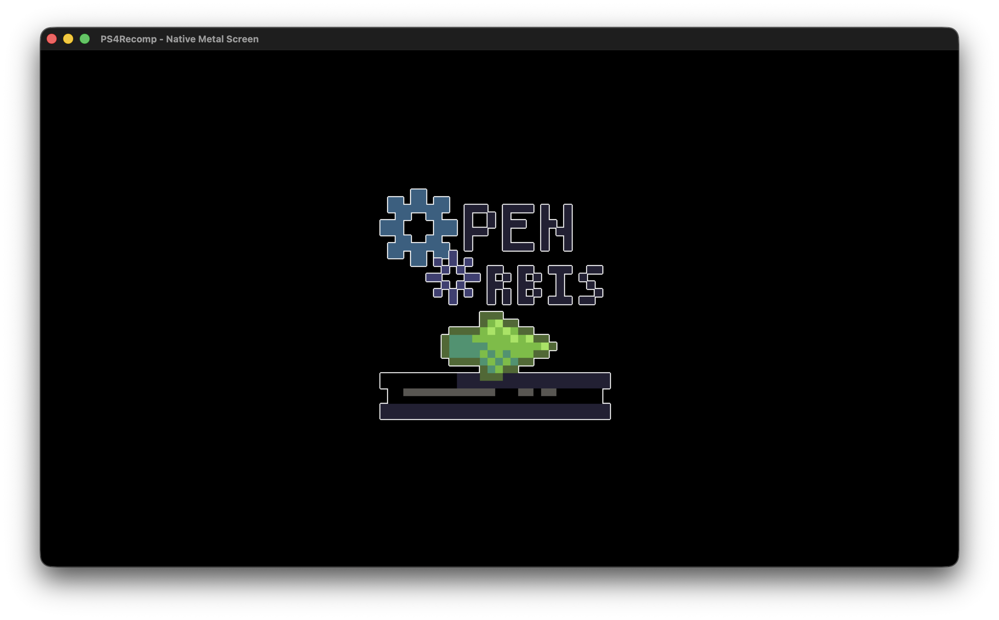

# PS4Recomp

A macOS Apple Silicon ahead-of-time (AOT) recompiler that translates PlayStation 4 (x86-64 ELF) binaries into native executables. No JIT, virtual machines, or MoltenVK required.

> [!TIP]
> This project is at a very early stage and not suitable for launching games. If you want to try to launch the game - we recommend trying the project fork **[ps4-native-mac](https://github.com/manjarqo/ps4-native-mac)**.


---

## Features

- **Native ARM64 Assembly AOT Compiler**: Recovers functions, CFG, and jump tables, translating AMD64 instructions directly into native ARM64 assembly (`.s`) chunks. Compiles via Apple Clang assembler in parallel without intermediate C translation overhead.
- **x86 Memory Ordering (TSO)**: Supports x86 Total Store Order via acquire/release semantics (`-tso`) on non-stack guest memory, preventing subtle multi-threaded race conditions in game engines and lock-free data structures.
- **Darwin ABI & Register Safety**: Pinned guest register architecture (`x28` memory base, `x27` TLS/FS base) while strictly respecting Darwin ARM64 calling conventions: `x18` (Apple platform-reserved) is untouched, `d8`-`d15` callee-saved registers are preserved, and stack alignment is verified.
- **Universal Multi-Module & Plugin Linking**: Recursively discovers and binds all companion `.prx` modules and game plugins throughout the application directory structure. Automatically relocates virtual memory spaces with zero collisions and merges symbols into a unified guest address space.
- **FreeBSD / Orbis OS Conforming Synchronization**: True guest-memory allocated synchronization primitives (`pthread_mutex_t`, `pthread_cond_t`, `pthread_rwlock_t`) supporting internal libc field accesses (such as Unity's `m_flags`), adaptive spinlocks, and fiber-aware thread ownership.
- **Native Metal Graphics & VideoOut**: Direct Apple Metal presentation with frame pacing (`ps4_metal_screen`, `ps4_present_queue`), hardware VSync, gamma correction, and zero-copy UMA physical direct memory aliasing (`mach_vm_remap`).
- **Orbis Kernel & POSIX Subsystems**: High-level emulation (HLE) of direct physical memory, event queues (`libkernel` equeues with condition broadcasting), asynchronous I/O (`aio`), and virtual file system virtualization (`/app0`).
- **Rich Media & Hardware Integration**: Multi-channel 48 kHz PCM audio mixer paced by device clock (`libSceAudioOut`), hardware AAC decoding via AudioToolbox (`libSceAudiodec`), native GameController gamepad input with hotkeys (`libScePad`), hardware ImageIO decoding (`libScePngDec`, `libSceJpegDec`), directory-based save data (`libSceSaveData`), and RFC-compliant datetime (`libSceRtc`).
- **Tooling & Standalone Bundling**: Automatic generation of self-contained macOS `.app` application bundles, resource staging, and ad-hoc code-signing.

---

## Quick Start

### Prerequisites

- macOS (Apple Silicon: M1 / M2 / M3 / M4)
- Go 1.22+
- Xcode Command Line Tools (`clang`, `clang++`)
- FreeType 2 (`brew install freetype`)
- Ninja (`brew install ninja`, recommended for fast parallel builds)

### Prerequisites for Commercial Games

PS4Recomp operates **exclusively on already decrypted and extracted game folders** containing the game's executable (`eboot.bin`) and assets. It does not parse or decrypt proprietary encrypted package containers directly.

To dump and extract your legally purchased game backups on macOS, we officially recommend using the native, open-source community tool **[ps4-pkg-tools](https://github.com/xXJSONDeruloXx/ps4-pkg-tools)** (supports both CLI and GUI interfaces).

### Cloning & 3rd-Party Dependencies

PS4Recomp relies on several 3rd-party submodules located in `3rdparty/`:

| Submodule                                | Purpose                                                                            | Integration / Output                                  |
| ---------------------------------------- | ---------------------------------------------------------------------------------- | ----------------------------------------------------- |
| **SPIRV-Cross** (`3rdparty/spirv-cross`) | Translates SPIR-V GPU shaders to Apple Metal Shading Language (MSL)                | Pre-built static library (`libspirv-cross.a`)         |
| **LibAtrac9** (`3rdparty/libatrac9`)     | ATRAC9 hardware/software audio decoder for PS4 AJM (`libSceAjm`)                   | Pre-built static library (`libatrac9.a`) or C sources |
| **minimp3** (`3rdparty/minimp3`)         | Lightweight MP3 audio decoding header for sound playback                           | Header-only (`minimp3.h`), auto-included              |
| **ffmpeg-core** (`3rdparty/ffmpeg-core`) | Multimedia decoding backend (H.264/AVC & HEVC) for video playback (`libSceAvcdec`) | Headers & libraries                                   |

```bash
# Clone repository with all submodules:
git clone --recursive https://github.com/wie-project/PS4Recomp.git
cd PS4Recomp

# Or if already cloned without --recursive:
git submodule update --init --recursive
```

### Building 3rd-Party Static Libraries & PS4Recomp

Before compiling games, build the static libraries for the 3rd-party dependencies:

#### 1. Build SPIRV-Cross

```bash
cd 3rdparty/spirv-cross
clang++ -O3 -std=c++17 -c spirv_cross.cpp spirv_cross_parsed_ir.cpp spirv_parser.cpp spirv_glsl.cpp spirv_msl.cpp spirv_cfg.cpp spirv_cross_c.cpp
ar rcs libspirv-cross.a *.o && rm -f *.o
cd ../..
```

#### 2. Build LibAtrac9

```bash
cd 3rdparty/libatrac9
clang -O3 -c C/src/*.c
ar rcs libatrac9.a *.o && rm -f *.o
cd ../..
```

#### 3. Build ps4-recomp binary

```bash
go build -o ps4-recomp ./cmd/ps4-recomp
```

---

## Usage Guide

### 1. Analyze a Binary

Scan CFGs, discover companion PRXs recursively, and report instruction compatibility for the decrypted executable:

```bash
./ps4-recomp analyze path/to/extracted_game/eboot.bin
```

### 2. Recompile to macOS `.app` Bundle

Recompile the extracted Orbis binary and package it into a native standalone application bundle:

```bash
# Basic compilation to native ARM64 binary with full TSO memory ordering
./ps4-recomp path/to/extracted_game/eboot.bin -o output_dir -c

# Full standalone package with VFS assets and resources included into macOS app bundle
./ps4-recomp path/to/extracted_game/eboot.bin --app-dir /path/to/extracted_game --copy-resources -o output_dir -c
```

### 3. CLI Options

| Flag                    | Description                                                          | Default       |
| ----------------------- | -------------------------------------------------------------------- | ------------- |
| `-o`, `-out <dir>`      | Output directory for generated code and binaries                     | `"build"`     |
| `-e`, `-elf <file>`     | Path to input PS4 ELF binary                                         | —             |
| `-c`, `-compile`        | Compile emitted assembly to native ARM64 binary with Clang           | `true`        |
| `-j`, `-jobs <num>`     | Number of parallel Clang assembler workers                           | `NumCPU`      |
| `-O`, `-opt <level>`    | Clang optimization level (`0`, `1`, `2`, `3`, `s`, `z`)              | `"2"`         |
| `-r`, `-run`            | Run the compiled binary after successful recompilation               | `false`       |
| `-t`, `-timeout <sec>`  | Watchdog timeout in seconds when running binary (`0` = no timeout)   | `0`           |
| `-a`, `-all-symbols`    | Recompile all symbols in symbol table even if unreachable            | `false`       |
| `-k`, `-chunk-size <n>` | Number of functions per emitted ARM64 assembly chunk file            | `250`         |
| `-v`, `-verbose`        | Enable verbose output and detailed timing breakdown                  | `false`       |
| `--tso`                 | x86 Total Store Order memory model (acquire/release on memory)       | `true`        |
| `--app-dir <dir>`       | Host directory mapping to `/app0` for game assets                    | Auto-detected |
| `--copy-resources`      | Copy all game assets/resources into macOS `.app` bundle `Resources/` | `false`       |
| `--asan`                | Compile runtime with AddressSanitizer and LeakSanitizer              | `false`       |

---

## Commercial Game Milestones

### Hollow Knight: Silksong (Unity 6 / Il2Cpp)

WARNING: Work on Silksong is frozen on the promotion of c++ exceptions for il2cpp. At the moment, Unity game testing is suspended

```text
[ps4-recomp] sceKernelDlsym: handle 5 symbol 'UnityShaderCompilerExtEvent' not found
[ps4-recomp] WARN: Called unimplemented function NID 'tlpXm5KLgqk' (Lib: libSceVrTracker) at RIP=0x8ad02e8 (caller RIP=0x8ae39eb, RSP=0x7ffff9ac8)
[ps4-recomp] WARN: Called unimplemented function NID 'wkgY4lDEV9k' (Lib: libSceVrTracker) at RIP=0x8ad16e8 (caller RIP=0x8ae39f7, RSP=0x7ffff9ac8)
[ps4-recomp] WARN: Called unimplemented function NID 'buMmdpEwRuM' (Lib: libSceVrTracker) at RIP=0x8ad16f8 (caller RIP=0x8ae3a0d, RSP=0x7ffff9ac8)
[ps4-recomp] WARN: Called unimplemented function NID 'El4tFb9f8dk' (Lib: libSceVrTracker) at RIP=0x8ad0128 (caller RIP=0x8ad36c4, RSP=0x7ffff9a68)
[ps4-recomp] WARN: Called unimplemented function NID 'El4tFb9f8dk' (Lib: libSceVrTracker) at RIP=0x8ad0128 (caller RIP=0x8ad37ac, RSP=0x7ffff9a68)
[ps4-recomp] WARN: Called unimplemented function NID 'El4tFb9f8dk' (Lib: libSceVrTracker) at RIP=0x8ad0128 (caller RIP=0x8ad37c9, RSP=0x7ffff9a68)
[ps4-recomp] WARN: Called unimplemented function NID 'ItZXngg8tfo' (Lib: libSceVrTracker) at RIP=0x8ad1708 (caller RIP=0x8ae3a6e, RSP=0x7ffff9ac8)
[ps4-recomp] sceKernelLoadStartModule: /app0/Media/Plugins/UnityNpToolkit2.prx
[ps4-recomp] sceKernelDlsym: handle 5 symbol 'UnitySetGraphicsDevice' not found
[ps4-recomp] sceKernelDlsym: handle 5 symbol 'UnityRenderEvent' not found
[ps4-recomp] sceKernelDlsym: handle 5 symbol 'UnityGetAudioEffectDefinitions' not found
[ps4-recomp] sceKernelDlsym: handle 5 symbol 'UnityPluginLoad' not found
[ps4-recomp] sceKernelDlsym: handle 5 symbol 'UnityPluginUnload' not found
[ps4-recomp] sceKernelDlsym: handle 5 symbol 'UnityRenderingExtEvent' not found
[ps4-recomp] sceKernelDlsym: handle 5 symbol 'UnityRenderingExtQuery' not found
[ps4-recomp] sceKernelDlsym: handle 5 symbol 'UnityShaderCompilerExtEvent' not found
[ps4-unwind] GetModuleInfoForUnwind: addr=0x9556ed1 -> mod=libc.prx, hdr=0x95ae9ec, frame=0x9583b30 (size=0x2aebc)
...
FATAL: guest C++ exception (type 22Il2CppExceptionWrapper) thrown from 0x290cfac: exception unwinding is not supported by the ARM64 assembly backend
Registers:
  RAX=0x000000001ae0d280 RBX=0x000000001a128dc0 RCX=0x00000000021047f8 RDX=0x0000000000000000
  RSI=0x0000000006bf0000 RDI=0x000000001ae0d280 RBP=0x00000007ffff98c0 RSP=0x00000007ffff98a8
  R8 =0x00000007ffff97d0 R9 =0x0000000019c00098 R10=0x0000000000000000 R11=0x000000000000001c
  R12=0x0000000000000061 R13=0x000000001addaaf0 R14=0x0000000000000061 R15=0x0000000060000000
```

### Hogwarts Legacy (Unreal Engine 4)

```text
[ps4-vfs] Application root: /Volumes/Samsung T7/Hogwarts Legacy Deluxe Edition/game
...
[ps4-recomp] WARN: Called unimplemented function 'sceContentExportInit2' (NID: 0GnN4QCgIfs, Lib: libSceContentExport) at RIP=0x70d5d00 (caller RIP=0x41709b0, RSP=0x7ffffe498)
[ps4-recomp] WARN: Called unimplemented function 'sceGameLiveStreamingInitialize' (NID: kvYEw2lBndk, Lib: libSceGameLiveStreaming) at RIP=0x70d5b00 (caller RIP=0x416e66e, RSP=0x7ffffe4d8)
[ps4-recomp] WARN: Called unimplemented function 'sceGameLiveStreamingEnableLiveStreaming' (NID: dWM80AX39o4, Lib: libSceGameLiveStreaming) at RIP=0x70d5c90 (caller RIP=0x416e7e7, RSP=0x7ffffe4f8)
[ps4-sys] open: '/app0/phoenix/intermediate/shaders/tmp' (resolved='/Volumes/Samsung T7/Hogwarts Legacy Deluxe Edition/game/phoenix/intermediate/shaders/tmp', flags=0x20000, host_flags=0x100000) -> fd=-1
[ps4-sys] open: '/app0/phoenix/intermediate/shaders/workingdirectory' (resolved='/Volumes/Samsung T7/Hogwarts Legacy Deluxe Edition/game/phoenix/intermediate/shaders/workingdirectory', flags=0x20000, host_flags=0x100000) -> fd=-1
[ps4-vm] recomp_vm_alloc_named_aligned (anon): size=200704 (0.19 MB) align=4096 flags=0x0
[ps4-vm] recomp_vm_alloc_named_aligned SUCCESS: addr=0x12d0a000
[ps4-thread] Thread started: id=1030, name='unnamed', entry=0x418df50, arg=0x100798bec0
[libSceNp] sceNpGameIntentInitialize

FATAL: Signal 10 at host address 0x7004543b90 (mem_base=0x7000000000)
```

---

## Project Structure

```text
├── cmd/
│   ├── ps4-recomp/              # Main CLI entry point
│   └── lifter-difftest-asm/     # AMD64 vs ARM64 assembly differential testing harness
└── pkg/
    ├── analyzer/                # Reachable CFG & instruction coverage analyzer
    ├── disasm/                  # Instruction decoder, jump-table & carry-liveness recovery
    ├── elfloader/               # ELF64/SELF/PRX parser, recursive companion module discovery
    ├── lifter/                  # AMD64 to ARM64 assembly lifter (TSO, locked RMW, FPU, SIMD)
    ├── emitter/                 # Assembly partitioner, bridge trampoline, shims & Ninja driver
    └── runtime/                 # macOS host runtime & Orbis/POSIX kernel ABI
        ├── core/                # Guest context, memory manager & Mach-O crash handlers
        ├── kernel/              # Direct memory aliasing, sync pools, threading, equeue, VFS
        └── modules/             # HLE modules (VideoOut, AudioOut, Audiodec, Pad, SaveData, RTC, etc.)
```

---

## Contributing Guidelines

- **English only**: All code comments, documentation, and commit messages must be written in English.
- **Strict verification**: All modifications must pass `go test -count=1 ./...` and `go vet ./...` cleanly with zero regressions. No artificial stubs returning 0 where honest implementation is required.
- **Multi-platform support**: macOS Apple Silicon remains the primary target architecture. Contributions for other platforms are welcome as long as they don't break or slow down macOS support.

---

## Credits & Acknowledgements

Special thanks to the open-source PlayStation emulation and research communities:

- **[ps4-native-mac](https://github.com/manjarqo/ps4-native-mac)** — The first fork of the project that improved the work of the original
- **[OpenOrbis](https://github.com/OpenOrbis)** — Open-source PS4 toolchain and reverse engineering.
- **[shadPS4](https://github.com/shadps4-emu/shadPS4)** — HLE module architecture and system behavior documentation.
- **[ps4libdoc](https://github.com/idc/ps4libdoc)** — Symbol dictionaries and NID-to-name mappings.

---

## Legal Notice

PS4Recomp is an independent educational and research project into ahead-of-time binary translation. It does not distribute, bundle, or contain any copyrighted PlayStation 4 system libraries, firmware files, or proprietary encryption keys. "PlayStation", "PlayStation 4", "PS4", and "Orbis OS" are registered trademarks of Sony Interactive Entertainment Inc. All commercial game titles and assets belong to their respective owners.

---

## License

[GPL-2.0](LICENSE)
